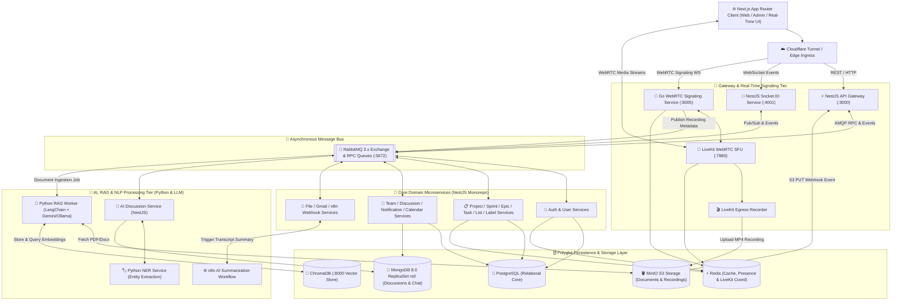
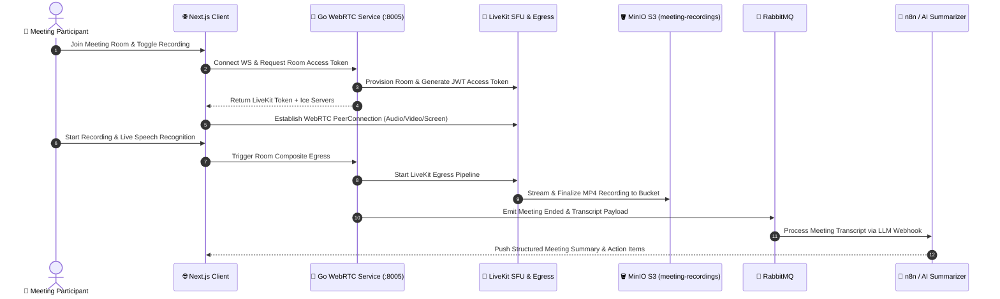

# 🚀 Taskora (DATN): Polyglot Microservices Collaborative Workspace, WebRTC Conferencing & AI Summarization Platform

[](https://nestjs.com/)
[](https://go.dev/)
[](https://nextjs.org/)
[](https://www.python.org/)
[](https://livekit.io/)
[](https://www.rabbitmq.com/)
[](https://www.trychroma.com/)
[](https://www.postgresql.org/)
[-47A248?style=flat&logo=mongodb)](https://www.mongodb.com/)
[](https://redis.io/)
[](https://min.io/)
[](https://www.docker.com/)

> **Taskora** is an enterprise-grade, polyglot microservices platform engineered for agile project management, real-time multi-party **WebRTC/LiveKit video conferencing**, automated **AI meeting transcription & summarization**, and **RAG-powered workspace document intelligence**.

---

## 📌 Table of Contents

- [Architectural Overview](#-architectural-overview)
- [System Architecture & Data Flows](#-system-architecture--data-flows)
  - [1. Global Polyglot Microservices Topology](#1-global-polyglot-microservices-topology)
  - [2. Real-Time WebRTC Conferencing & Automated Egress Recording Flow](#2-real-time-webrtc-conferencing--automated-egress-recording-flow)
  - [3. Event-Driven RAG Document Ingestion & AI Summarization Pipeline](#3-event-driven-rag-document-ingestion--ai-summarization-pipeline)
- [Microservices & Domain Catalog](#-microservices--domain-catalog)
- [Technology Stack](#-technology-stack)
- [Performance & Caching Benchmark Proof](#-performance--caching-benchmark-proof)
- [Quickstart & Deployment](#-quickstart--deployment)
- [License](#-license)

---

## 🏗 Architectural Overview

Taskora decouples synchronous user interactions from compute-intensive media streaming and AI inference using a **polyglot microservices architecture**:

1. **API Gateway & 16 NestJS Domain Microservices**: Centralized HTTP/REST entry point (`api-gateway`) routing commands and queries to specialized domain services over **RabbitMQ RPC / Event Bus** and **gRPC**.
2. **High-Performance Go WebRTC & LiveKit SFU Media Tier**: Dedicated **Go (`web_rtc`)** signaling service paired with **LiveKit Server (SFU)** and **LiveKit Egress** to handle low-latency multi-party video rooms and automatic MP4 stream recording into **MinIO S3 buckets**.
3. **Event-Driven AI / RAG & NLP Pipeline**: **Python workers (`chatbot-service`, `ner-service`)** and **n8n automation workflows** consume document-upload webhooks from MinIO via RabbitMQ, chunk and embed documents into **ChromaDB**, extract named entities, and generate automated meeting summaries via **Google Gemini / Ollama**.
4. **Polyglot Persistence Layer**: Combines **PostgreSQL** (transactional project/sprint/task data), **MongoDB 8.0 Replica Set (`rs0`)** (high-write chat/discussion logs), **ChromaDB** (vector embeddings), **Redis** (hot caching & WebSocket pub/sub state), **Meilisearch** (instant full-text search), and **MinIO** (S3-compatible object storage).

---

## 🔄 System Architecture & Data Flows

### 1. Global Polyglot Microservices Topology



### 2. Real-Time WebRTC Conferencing & Automated Egress Recording Flow



### 3. Event-Driven RAG Document Ingestion & AI Summarization Pipeline

1. **Direct S3 Upload & Webhook Trigger**: When a team member uploads a specification or document to the `documents` bucket in **MinIO**, MinIO fires an automated `s3:ObjectCreated:Put` webhook to `http://api-gateway:3000/webhooks/upload-completed`.
2. **Asynchronous Queue Decoupling**: `api-gateway` validates the payload and dispatches an ingestion message to **RabbitMQ**, immediately freeing the HTTP thread.
3. **Vectorization & Indexing**: The **Python Chatbot Worker (`python/chatbot-service`)** streams the file from MinIO, performs text chunking, generates vector embeddings, and indexes them into **ChromaDB**.
4. **Contextual RAG & NER**: During team discussions, users query the AI assistant or invoke Named Entity Recognition (`python/ner-service`) to extract tasks, deadlines, and assignees directly from conversation threads.

---

## 🧩 Microservices & Domain Catalog

| Service / Module | Tech Stack | Responsibility |
| :--- | :--- | :--- |
| **`frontend`** | Next.js (App Router), TypeScript, Tailwind CSS | Interactive Kanban boards, Backlog management, LiveKit video room UI, AI chat & analytics dashboard. |
| **`api-gateway`** | NestJS, TypeScript, RabbitMQ | Unified API ingress, JWT guard validation, MinIO webhook ingestion, and request fan-out to microservices. |
| **`auth` & `user`** | NestJS, PostgreSQL, Redis | Authentication, OAuth2/JWT session lifecycle, RBAC permissions, and user profile management. |
| **`project` / `sprint` / `epic` / `task` / `list` / `label`** | NestJS, PostgreSQL, Redis | Agile project lifecycle management, sprint velocity tracking, drag-and-drop position indexing, and Redis caching. |
| **`team` / `discussion` / `calendar` / `notification`** | NestJS, MongoDB (`rs0`), PostgreSQL | Multi-tenant team workspaces, threaded discussions, calendar scheduling, and real-time alert delivery. |
| **`socket`** | NestJS, Socket.IO, Redis | Real-time bidirectional state synchronization for task boards, presence indicators, and chat rooms. |
| **`file` / `gmail` / `n8n-service`** | NestJS, MinIO SDK, REST | Presigned S3 URL generation, automated Gmail notifications, and n8n AI workflow orchestration. |
| **`web_rtc`** | Go 1.21+, Gorilla WebSocket, LiveKit SDK | High-concurrency signaling server, LiveKit SFU room lifecycle management, and Egress recording orchestration. |
| **`chatbot-service` & `ner-service`** | Python 3.10+, LangChain, ChromaDB, Gemini/Ollama | Asynchronous RAG document ingestion worker, vector similarity retrieval, and Named Entity Recognition (NER). |

---

## 🛠 Technology Stack

- **Frontend**: Next.js, React, TypeScript, Tailwind CSS, Shadcn UI, Socket.IO Client, LiveKit Components
- **Backend Microservices**: Node.js, NestJS (Monorepo), Go (Golang), Python
- **Real-Time & Media**: LiveKit Server (WebRTC SFU), LiveKit Egress, Socket.IO, Gorilla WebSocket
- **AI & Data Science**: Google Gemini API, Ollama, LangChain, ChromaDB (Vector Database), Custom Python NER Pipeline, n8n Workflow Automation
- **Databases & Storage**: PostgreSQL, MongoDB 8.0 (Replica Set `rs0`), Redis, MinIO (S3-compatible Object Storage), Meilisearch
- **Messaging & IPC**: RabbitMQ (AMQP 0-9-1), gRPC, REST Webhooks
- **DevOps & Edge**: Docker, Docker Compose, GitHub Actions CI/CD, Cloudflare Tunnel (`cloudflared`)

---

## 📊 Performance & Caching Benchmark Proof

Taskora implements a **Redis Look-Aside Caching Layer** across high-read Agile board endpoints. Below are the A/B load-testing results (`backend/load-test.js` & `backend/summary_report.md`) comparing direct PostgreSQL queries (**Cold Hit**) against Redis-cached responses (**Warm Hit**):

| Concurrency Tier (VUs) | Cold Hit Latency (PostgreSQL) | Warm Hit Latency (Redis Cache) | API Error Rate | Sustained Throughput |
| :--- | :--- | :--- | :--- | :--- |
| **50 VUs** | 28.76 ms | **23.33 ms** | `0.00%` | **2,980 reqs/min** |
| **100 VUs** | 31.36 ms | **29.43 ms** | `0.00%` | **5,910 reqs/min** |
| **200 VUs** | 231.22 ms | **232.36 ms** | `0.00%` | **9,906 reqs/min** |

- **Zero Error Invariant (`0.00%`)**: Sustained nearly **10,000 requests/minute** at 200 concurrent virtual users with zero dropped connections or HTTP 5xx failures.
- **Database Offloading**: Redis absorbs repetitive sprint/board state lookups, protecting PostgreSQL connection pools during peak team standups.

---

## 🏁 Quickstart & Deployment

### Prerequisites

- **Docker** & **Docker Compose** (v2+)
- **Node.js** (v18+), **Go** (v1.21+), **Python** (v3.10+) *(for local non-containerized development)*

### 1. Clone the Repository

```bash
git clone https://github.com/janhae4/DATN.git
cd DATN
```

### 2. Configure Environment Variables

Initialize environment files for the root orchestrator and individual service tiers:

```bash
chmod +x setup_env.sh
./setup_env.sh
```
*(Or copy `.env.example` to `.env`, `./backend/.env.dev`, `./web_rtc/.env`, and `./python/chatbot-service/chatbot.env`).*

### 3. Launch the Full Polyglot Stack

Start all infrastructure containers (RabbitMQ, Redis, PostgreSQL, MongoDB ReplicaSet, ChromaDB, MinIO, LiveKit) and application microservices:

```bash
docker compose up -d --build
```

> **Note:** The `minio-setup` and `mongo_rs_init` sidecar containers automatically initialize the MongoDB `rs0` replica set, create the `meeting-recordings` and `documents` S3 buckets, and register the MinIO webhook notification to `api-gateway`.

### 4. Service Endpoints

| Service | Local URL | Description |
| :--- | :--- | :--- |
| **Frontend Web App** | `http://localhost:5000` | Next.js Collaborative Workspace UI |
| **API Gateway** | `http://localhost:3000` | Primary NestJS REST Ingress |
| **Socket.IO Server** | `ws://localhost:4001` | Real-Time Board & Chat WebSocket |
| **Go WebRTC Service** | `http://localhost:8005` | WebRTC Signaling & Recording Controller |
| **LiveKit SFU Server** | `http://localhost:7880` | WebRTC Media Server |
| **RabbitMQ Management** | `http://localhost:15672` | Message Broker UI (`guest` / `guest`) |
| **MinIO Console** | `http://localhost:9001` | S3 Object Storage UI (`minioadmin` / `minioadmin`) |
| **ChromaDB Server** | `http://localhost:8000` | Vector Database API |

---

## 📖 Documentation

- **[MinIO Webhook Setup Guide](./docs/minio-setup.md)**: Detailed configuration for S3 bucket event notifications.
- **[Redis Cache Benchmark Report](./backend/summary_report.md)**: Full load-testing methodology and metrics.

---

## 📝 License

Developed as a Capstone / Graduation Thesis Project (**DATN**) by [**janhae4**](https://github.com/janhae4). Distributed under the MIT License.
